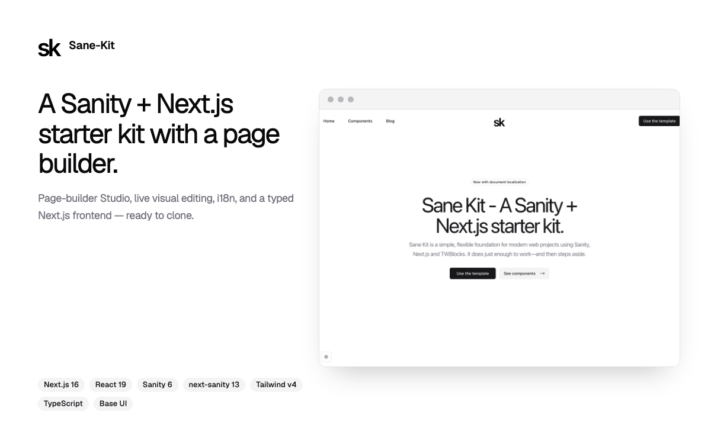

# Sane-Kit

[](https://nextjs.org/) [](https://www.sanity.io/) [](https://reactjs.org/) [](https://www.typescriptlang.org/) [](https://tailwindcss.com/) [](https://ui.shadcn.com/)

A Sanity + Next.js starter kit: a monorepo with a page-builder frontend and a
customizable Studio. Built on the 2026 stack.

<!-- Add a 1200×750 screenshot (Sanity Exchange requirement) and uncomment:

-->

> **2026 release.** Upgraded to Next.js 16 · React 19 · Sanity 6 · next-sanity 13,
> with `sanityFetch` live content and an optimistic page builder. See
> [`CHANGELOG.md`](./CHANGELOG.md) and [`docs/RELEASE.md`](./docs/RELEASE.md).

|          |                                                                            |
| -------- | -------------------------------------------------------------------------- |
| Frontend | **Next.js 16** (App Router, Turbopack) · **React 19** · **next-sanity 13** |
| Studio   | **Sanity 6** · `@sanity/document-internationalization` · Presentation tool |
| UI       | **Tailwind CSS v4** · shadcn/ui (Radix)                                    |
| Tooling  | **pnpm 10 workspaces** · **Turborepo** · TypeScript · ESLint (flat config) |

## Features

- **Page builder** with 12+ section types (hero, features, pricing, FAQ, CTA, blog, contact, newsletter, …).
- **Typed content end to end** — Sanity TypeGen with `overloadClientMethods`; no hand-written query types.
- **Live Content API** (`defineLive` / `<SanityLive />`) — published changes appear without a redeploy.
- **Visual Editing + Presentation** — click-to-edit overlays and draft preview, with block-level updates.
- **Document internationalization** (English / Portuguese) via the official Sanity plugin.
- **Live Content & revalidation** — `<SanityLive />` streams published changes without a redeploy; a Sanity webhook (declared in `sanity.blueprint.ts`) drives tag-based revalidation.
- **SEO** — `sitemap.xml`, `robots.txt`, RSS feed, Open Graph metadata.
- **Analytics** — GA4 via `@next/third-parties`, PostHog, both consent-gated.

## Repository layout

```
sane-kit/
├── frontend/   # Next.js app (routes under src/app/[locale])
│   └── src/sanity/   # env, client, live, image, queries, generated types
├── studio/     # Sanity Studio (schemas, structure, presentation resolver)
├── functions/  # Sanity Functions (deployed via the Blueprint)
├── sanity.blueprint.ts   # project setup as code (CORS, webhook, functions)
├── turbo.json
└── pnpm-workspace.yaml
```

## Getting started

Requires **Node 24** and **pnpm 10**.

```bash
pnpm install
cp frontend/.env.example frontend/.env.local   # fill in your Sanity project
cp studio/.env.example studio/.env.local
pnpm dev
```

- Frontend: http://localhost:3000
- Studio: http://localhost:3333

## Environment variables

`frontend/.env.local`

| Variable                            | Required     | Purpose                                                        |
| ----------------------------------- | ------------ | -------------------------------------------------------------- |
| `NEXT_PUBLIC_SANITY_PROJECT_ID`     | yes          | Sanity project id                                              |
| `NEXT_PUBLIC_SANITY_DATASET`        | yes          | Dataset (e.g. `production`)                                    |
| `NEXT_PUBLIC_SANITY_API_VERSION`    | no           | API version date (default `2026-10-01`)                        |
| `NEXT_PUBLIC_SANITY_STUDIO_URL`     | no           | Studio URL for click-to-edit (default `http://localhost:3333`) |
| `NEXT_PUBLIC_SITE_URL`              | no           | Canonical site URL (sitemap, RSS, OG)                          |
| `SANITY_API_READ_TOKEN`             | for previews | Viewer token — enables Draft Mode + Live Content               |
| `SANITY_REVALIDATE_SECRET`          | for webhooks | Shared secret for `/api/revalidate`                            |
| `NEXT_PUBLIC_GA_MEASUREMENT_ID`     | no           | Google Analytics 4                                             |
| `NEXT_PUBLIC_POSTHOG_KEY` / `_HOST` | no           | PostHog                                                        |
| `RESEND_API_KEY`                    | for forms    | Resend API key (contact + newsletter forms)                    |
| `CONTACT_FORM_TO`                   | for forms    | Recipient inbox for the contact form                           |
| `CONTACT_FORM_FROM`                 | for forms    | Verified Resend sender, e.g. `Sane Kit <hello@yourdomain.com>` |

`studio/.env.local`: `SANITY_STUDIO_PROJECT_ID`, `SANITY_STUDIO_DATASET`,
`SANITY_STUDIO_SITE_URL` (the frontend origin used by the Presentation tool).

## Locales

Languages live in Sanity as `locale` documents — the single source of truth used
by the Studio's translation workflow. Seed them once (the `tag` must match the
frontend route segment):

```bash
pnpm --filter studio exec sanity dataset import seed/locales.ndjson production
```

## Scripts

```bash
pnpm dev          # run frontend + studio (Turborepo)
pnpm build        # build both
pnpm typecheck    # tsc across workspaces
pnpm lint         # eslint across workspaces
pnpm test         # Vitest unit tests
pnpm test:e2e     # Playwright smoke tests (builds + starts the production server)
pnpm typegen      # extract schema + regenerate frontend/src/sanity/types.ts
pnpm blueprint:plan    # preview Blueprint changes (CORS, webhook, functions)
pnpm blueprint:deploy  # apply the Blueprint to your Sanity project
pnpm verify       # typecheck + typecheck:blueprint + lint + build + test
```

## TypeGen

Types are generated from the Studio schema and the GROQ queries in
`frontend/src`. Config lives in `studio/sanity.cli.ts` (`typegen`), and
`typegen.enabled` regenerates during `sanity dev`/`sanity build`. Run
`pnpm typegen` after changing a schema or a query.

## Visual Editing / previews

1. Create a **Viewer** API token in Sanity and set `SANITY_API_READ_TOKEN`.
2. Add the frontend origin to the project's **CORS origins** with
   **Allow credentials**:
   ```bash
   pnpm --filter studio exec sanity cors add http://localhost:3000 --credentials
   ```
3. Open the **Presentation** tool in the Studio — the site loads in an iframe
   with click-to-edit overlays.

## On-demand revalidation

Create a Sanity webhook pointing at `https://your-site/api/revalidate` with the
secret set to `SANITY_REVALIDATE_SECRET`, and a projection that returns the
tags to invalidate, e.g.:

```json
{ "tags": [_type, _type + ":" + slug.current] }
```

Or declare it in code with Blueprints (`sanity.blueprint.ts` at the repo root,
which also sets up CORS) — see [`docs/RELEASE.md`](./docs/RELEASE.md):

```bash
pnpm blueprint:plan
pnpm blueprint:deploy
```

## Redirects

Editors manage 307/308 redirects with the **Redirect** document type in the
Studio. `next.config.ts` loads them in `redirects()` at build time, so a new
redirect takes effect on the next deploy.

## Deployment

- **Studio:** `pnpm --filter studio deploy`.
- **Frontend:** deploy `frontend/` to Vercel (or any Next host); set the
  environment variables above, then re-check CORS.

## Agent rules

Sanity schema/query conventions follow the official **`sanity-best-practices`**
agent skill. Turborepo guidance ships with the installed `turbo` package.

## License

MIT — see [LICENSE](./LICENSE).
